 <p align="center">
  
</p>

<p align="center">
  <a href="https://github.com/visty-exe">
    
  </a>
  <a href="https://www.linkedin.com/in/visty/">
    
  </a>
  
</p>

<h3 align="center">Building products, solving problems, learning every day.</h3>

<p align="center">
  Full Stack Developer · B.Tech CSE Student · Java & DSA
</p>

---

## `01` — About Me

```js
const vishal = {
  role: "Full Stack Developer",
  stack: ["React", "Node.js", "Express", "MongoDB"],
  languages: ["JavaScript", "Java", "Python"],
  interests: [
    "Building real-world applications",
    "Backend engineering",
    "AI-powered products",
    "Problem solving"
  ],
  currentlyLearning: "Java + Data Structures & Algorithms",
  mindset: "Build. Break. Debug. Improve."
};
```

I enjoy turning ideas into practical web applications — from responsive interfaces and REST APIs to authentication, databases, and real-time features.

My goal is to build software that is useful, reliable, and thoughtfully engineered.

## `02` — Tech Stack

<p>
  
</p>

**Core areas:** Full-stack development · REST APIs · JWT authentication · Socket.IO · MongoDB · Manual and regression testing

## `03` — Featured Projects

<table>
  <tr>
    <td width="50%" valign="top">
      <h3>Preply — AI Interview Prep</h3>
      An AI-powered interview preparation platform designed to help candidates practise interviews and improve their readiness.
      <br/><br/>
      <b>Built with</b><br/>
      React · Node.js · Express · MongoDB · AI APIs
      <br/><br/>
      <a href="https://preplyapp.vercel.app/">Live Demo ↗</a>
      ·
      <a href="https://github.com/visty-exe/AI_Interview_Prep">Source Code ↗</a>
    </td>
    <td width="50%" valign="top">
      <h3>Real-Time Chat</h3>
      A real-time messaging application with private communication and Socket.IO-powered updates.
      <br/><br/>
      <b>Built with</b><br/>
      Node.js · Express · Socket.IO · MongoDB
      <br/><br/>
      <a href="https://chatnow-0stp.onrender.com/">Live Demo ↗</a>
      ·
      <a href="https://github.com/visty-exe/Real-Time-Chat-App">Source Code ↗</a>
    </td>
  </tr>
  <tr>
    <td width="50%" valign="top">
      <h3>MERN Blog Platform</h3>
      A full-stack blogging platform with authentication, post management, comments, and image uploads.
      <br/><br/>
      <b>Built with</b><br/>
      React · Node.js · Express · MongoDB · MUI
      <br/><br/>
      <a href="https://mern-blog-platform-hisp-cyan.vercel.app/">Live Demo ↗</a>
      ·
      <a href="https://github.com/visty-exe">GitHub ↗</a>
    </td>
    <td width="50%" valign="top">
      <h3>Real-Time Weather</h3>
      A responsive weather application for checking weather information with a clean interface.
      <br/><br/>
      <b>Built with</b><br/>
      React · JavaScript · Weather API
      <br/><br/>
      <a href="https://github.com/visty-exe/Real-Time-Weather">Source Code ↗</a>
    </td>
  </tr>
</table>

## `04` — Experience

**Software Testing Intern — R Cube Green Technology**  
*May 2026 – July 2026*

- Executed 400+ manual test cases across ERP modules.
- Reported and documented software defects with reproduction steps and severity.
- Performed regression testing and verified fixes.

**Web Development Training — Netcamp Solutions**  
*February 2026 – March 2026*

- Practised HTML, CSS, JavaScript, responsive design, and web development fundamentals.

## `05` — GitHub Activity

<p align="center">
  
  
</p>

<p align="center">
  
</p>

## `06` — Contribution Snake

<p align="center">
  <picture>
    <source media="(prefers-color-scheme: dark)" srcset="https://raw.githubusercontent.com/visty-exe/visty-exe/output/github-snake-dark.svg">
    <source media="(prefers-color-scheme: light)" srcset="https://raw.githubusercontent.com/visty-exe/visty-exe/output/github-snake.svg">
    
  </picture>
</p>

## `07` — Education

**B.Tech in Computer Science & Engineering**  
Raj Kumar Goel Institute of Technology, Ghaziabad · 2024–2028

---

<p align="center">
  <b>One commit at a time.</b>
  <br/>
  <sub>Build useful things. Master the fundamentals. Keep moving forward.</sub>
</p>

<p align="center">
  
</p>
